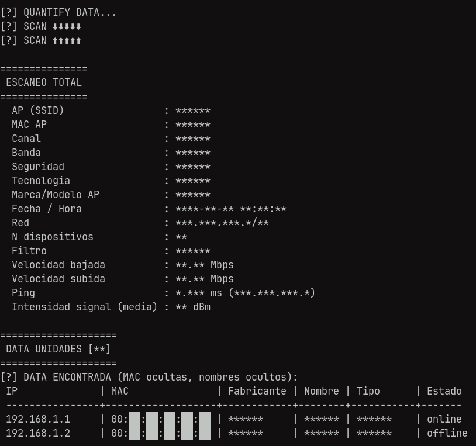

<h1 align="center" id="title">RED</h1>

<p align="center">
  <b>NETWORK TOOLS</b><br>
  herramientas de red
</p>

<p align="center">
	
</p>

[](https://www.python.org/downloads/)

# **ACERCA DE RED**
_El programa RED, cuenta con 2 apartados, tanto un escaneo total como herramientas para complementar:_

_El escaneo ultimate mide y registra la velocidad de bajada y subida de la red así como la identificación de parámetros del punto de acceso (MAC, canal, intensidad, seguridad, tecnología), de la cual, contabiliza los equipos conectados en los momentos de las pruebas, tiene opción de guardado de data en un archivo excel_

_En herramientas, hay mapeo de dispositivos, monitoreo de dispositivos, escaneo de puertos, búsqueda de DNS, ping y supervisión de servicios, análisis avanzado de nombres NetBIOS, UPnP y Bonjour, propiedades y tipos de dispositivos y información básica del equipo y la red_

## **ESCANEO ULTIMATE**
### APARTADO 1

* AP (SSID)
* MAC AP
* Canal
* Banda
* Seguridad
* Tecnología
* Marca/Modelo del acces point
* Fecha / Hora 
* Nº de dispositivos conectados
* Velocidad Bajada (Mbps)
* Velocidad Subida (Mbps)
* Ping (ms)
* Intensidad señal (dBm) — valor promedio
* IP detectada
* MAC
* Fabricante
* Nombre del dispositivo 
* Estado (online/offline)

## **Herramientas**
### APARTADO 2
| HERRAMIENTAS  | INFO                                       |
| ------------- |:------------------------------------------:|
| scan          | escaneo inicial (apartado 1)               |
| info          | informacion basica del equipo y la red     |
| upnp          | escaneo UPnP/DLNA                          |
| bonjour       | navegador Bonjour/mDNS                     |
| wifi          | escaneo wifi                               |
| speedtest     | medicion de velocidad                      |
| isp           | analisis del ISP y ubicacion               |
| connectivity  | verificador de conectividad a internet     |
| intruders     | deteccion de intrusos                      |
| inventory     | inventario de dispositivos                 |
| macs          | mostrar MAC + nombre + fabricante          |
| lan           | dispositivos de la red local               |
| subnet        | escaner de subred                          |
| ping          | ping ICMP/TCP/HTTP                         |
| trace         | traceroute / traceroute visual             |
| portscan      | escaner de puertos TCP                     |
| whois         | consulta WHOIS                             |
| dns           | busqueda DNS directa e inversa             |
| wol           | wake on LAN                                |
| ipcalc        | calculadora IP                             |
| watcher       | monitor continuo de recursos remotos       |
| monitor       | monitoriza dispositivos online/offline     |
| connect       | conectar a un puerto (navegador/SSH/FTP)   |


## **Instalacion**

- [Python 3](https://www.python.org/downloads/)
- [Git](https://git-scm.com/downloads)

```
$ git clone https://github.com/G0command/RED.git
$ cd ./RED
$ python3 red.py
```

## **Uso y ejemplos**

```
usage: red.py [-h] [--no-color] {scan,info,upnp,bonjour,wifi,speedtest,isp,connectivity,intruders,inventory,macs,lan,subnet,ping,trace,portscan,whois,dns,wol,ipcalc,watcher,monitor,connect} ...

$ python3 red.py 

$ python3 red.py scan --excel --excel-dir ~/escaneos
$ python3 red.py scan --hide-mac --hide-names --excel-file reporte.xlsx
$ python3 red.py wifi --verify
$ python3 red.py scan --speed
$ python3 red.py ping 1.1.1.1 --tcp 443
$ python3 red.py portscan 192.168.1.1 -p 22,80,443
$ python3 red.py --help
```


### Test:
<p align="center">
	
</p>


### **IMPORTANTE**

**Herramienta dise;ada para propositos educativos y aplicado en entornos insitucionales**

